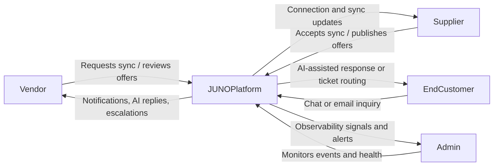
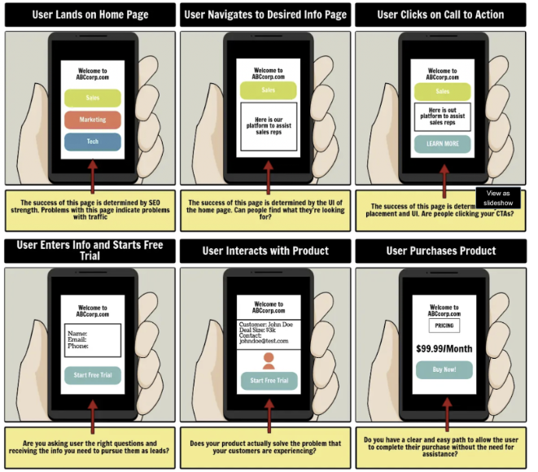
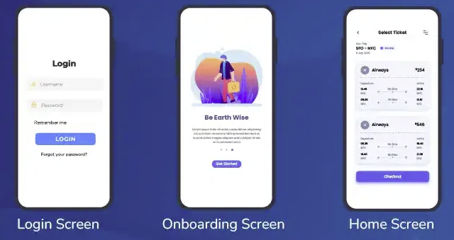
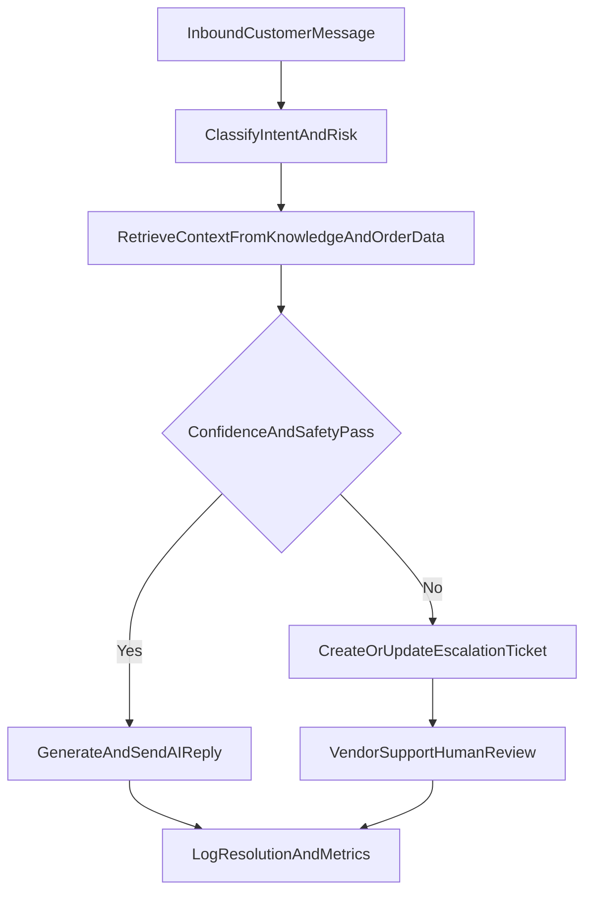
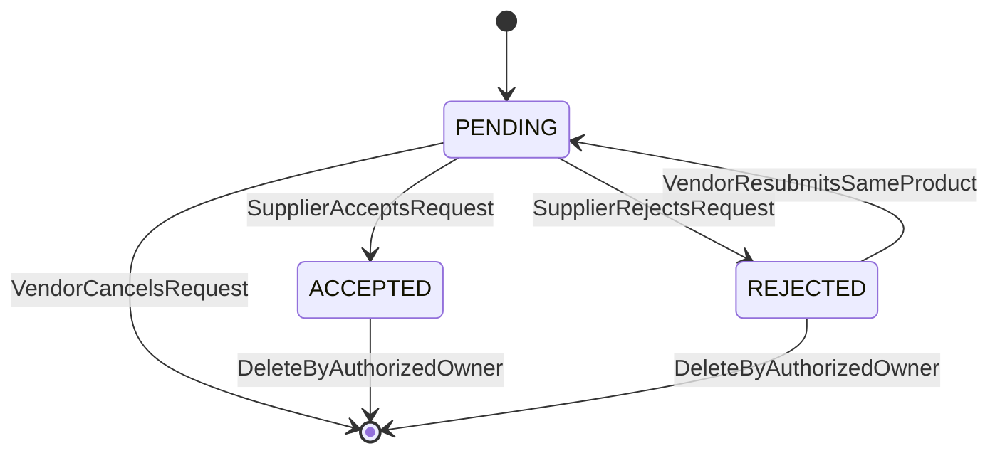

# Section 2: Project Requirements

This section defines the project requirements for JUNO. It translates the project context from Section 1 into concrete user interactions, functional requirements, and measurable non-functional requirements for the implemented scope.

## 2.1 Use-case / Event-Response / Storyboarding

JUNO supports multi-role interactions between Vendor, Supplier, Admin, and End Customer (external actor through storefront chat and email channels). The following use cases capture the most critical operational and support flows.

### 2.1.1 Role-Centric Use-Case Interaction Diagram

### 2.1.2 Core Use Cases

#### UC-01: Vendor Requests Product Sync from Supplier

- **Primary Actor:** Vendor  
- **Supporting Actor:** Supplier  
- **Preconditions:** Vendor account and store are onboarded; vendor-supplier connection exists; target supplier product is discoverable.  
- **Trigger:** Vendor selects supplier product and initiates sync request.  
- **Main Flow:**
  1. Vendor opens supplier product details.
  2. Vendor submits sync request to supplier.
  3. System stores request with pending status.
  4. Supplier receives notification and reviews request.
  5. Supplier accepts request.
  6. System updates status and exposes synced product for vendor operations.
- **Alternate/Error Flows:**
  - Supplier rejects request; system records rejection reason and notifies vendor.
  - Request times out without action; system marks stale status and keeps vendor informed.
- **Postconditions:** Request status is finalized as accepted or rejected; both roles can audit the decision trail.

#### UC-02: Supplier Publishes Vendor-Specific Offer

- **Primary Actor:** Supplier  
- **Supporting Actor:** Vendor  
- **Preconditions:** Active vendor-supplier relationship exists; relevant product has synced or is eligible for offer mapping.  
- **Trigger:** Supplier creates or updates an offer for a specific vendor.  
- **Main Flow:**
  1. Supplier selects vendor and product.
  2. Supplier enters vendor-specific price, quantity, and terms.
  3. System validates offer constraints and saves versioned offer.
  4. Vendor receives notification and views updated offer details.
- **Alternate/Error Flows:**
  - Invalid pricing/quantity values are rejected with corrective guidance.
  - Offer conflicts with existing state; system requests explicit overwrite confirmation.
- **Postconditions:** Vendor-visible offer is updated and available for decision-making.

#### UC-03: Customer Inquiry is Auto-Handled with Escalation Safety

- **Primary Actor:** End Customer (external)  
- **Supporting Actors:** Vendor support operator, AI helpdesk pipeline  
- **Preconditions:** Chat/email channel is connected; retrieval content and policy checks are available.  
- **Trigger:** Customer sends a message about order status, return, shipping, or cancellation.  
- **Main Flow:**
  1. System receives inbound message.
  2. Message is classified and normalized.
  3. Knowledge retrieval and contextual checks run.
  4. AI drafts or sends response for low-risk scenarios.
  5. If confidence/risk thresholds fail, system creates or updates escalation ticket.
  6. Vendor support operator handles escalated case.
- **Alternate/Error Flows:**
  - Missing context leads to a clarification question instead of direct resolution.
  - Safety or policy violation triggers immediate human-only handling.
- **Postconditions:** Customer receives a timely response, with risky cases routed to human review.

#### UC-04: Admin Monitors Operational Health

- **Primary Actor:** Admin  
- **Preconditions:** Admin access is active; observability data is available.  
- **Trigger:** Admin opens monitoring dashboard.  
- **Main Flow:**
  1. Admin reviews stores, sync trends, and communication events.
  2. Admin inspects anomalies (e.g., failed sync spikes, unresolved escalations).
  3. Admin drills into event streams for diagnosis and governance.
- **Postconditions:** Admin captures actionable insights and flags issues for operational follow-up.

### 2.1.3 Event-Response Table (Operationally Critical Events)

| Event ID | Event / Stimulus | Source Actor / System | System Response | Expected Outcome |
| --- | --- | --- | --- | --- |
| EVT-01 | Vendor submits product sync request | Vendor | Create pending sync record, notify supplier, log event | Supplier receives actionable request |
| EVT-02 | Supplier accepts sync | Supplier | Mark request accepted, update vendor-facing availability, notify vendor | Product collaboration continues with latest status |
| EVT-03 | Supplier rejects sync | Supplier | Mark request rejected, attach optional reason, notify vendor | Vendor gets clear rejection context |
| EVT-04 | New offer created/updated | Supplier | Validate and persist offer, emit notification/event | Vendor sees latest offer terms |
| EVT-05 | Customer sends support message | End Customer | Classify message, run retrieval, draft/send AI reply or escalate | Fast first response with safer routing |
| EVT-06 | Confidence below threshold | AI Pipeline | Create escalation ticket, attach context and evidence | Human support takes over high-risk case |
| EVT-07 | Webhook sync failure detected | Commerce sync subsystem | Record failure, retry strategy, notify operational channel | Reliability protections trigger early |
| EVT-08 | Admin reviews anomaly | Admin | Provide filtered event trail and affected entities | Faster diagnosis and governance |

### 2.1.4 Storyboarding References (Visual Context)

The following existing assets are reused as storyboard-style visual references where they support readability:

- Generic storyboard reference:  
  
- Generic UI reference (to illustrate interaction framing):  
  

These images are examples, while the requirement definitions in this section remain JUNO-specific.

### 2.1.5 Support Escalation Process Flow

### 2.1.6 Detailed Event and State Behavior

This subsection captures explicit state behavior reflected in the current implementation so requirements remain testable against real system behavior.

#### Product Sync State Transitions

**Behavior notes:**

- Sync request uniqueness is scoped to `storeId + supplierId + shopifyProductId`.
- A previously rejected sync can be reopened as `PENDING` instead of creating a duplicate row.
- Suppliers can decide pending requests, but cannot delete a pending request (they must reject).
- Accepted sync records preserve supplier-available quantity snapshot in product data when inventory is derivable.

#### Storefront Support Escalation Trigger Behavior

- Escalation ticket creation is triggered when AI output indicates explicit escalation intent (tool/module signal or escalation phrase).
- Escalation artifacts are persisted through `EmailLog` with trigger classification for vendor follow-up threads.
- Existing escalation thread keys are reused/updated to avoid duplicate ticket spam for the same storefront issue.

## 2.2 Functional Requirements

Functional requirements are organized by implemented modules from Section 1, with unique IDs and testable statements.

### 2.2.1 Module A: Identity, Access, and Workspace

| Requirement ID | Functional Requirement |
| --- | --- |
| FR-IAM-01 | The system shall authenticate users and bind each account to an approved role (`Vendor`, `Supplier`, or `Admin`). |
| FR-IAM-02 | The system shall enforce role-based access controls on routes, APIs, and workspace features. |
| FR-IAM-03 | The system shall maintain active store context for vendor operations and reject store-scoped actions without valid context. |
| FR-IAM-04 | The system shall prevent unauthorized cross-role data visibility by default. |
| FR-IAM-05 | The system shall record authentication and authorization decision events for auditability. |

### 2.2.2 Module B: Vendor-Supplier Collaboration

| Requirement ID | Functional Requirement |
| --- | --- |
| FR-COLLAB-01 | The system shall allow vendors to create supplier connection/invitation requests and track relationship status. |
| FR-COLLAB-02 | The system shall allow vendors to submit product sync requests to connected suppliers. |
| FR-COLLAB-03 | The system shall allow suppliers to accept or reject sync requests with persisted status transitions. |
| FR-COLLAB-04 | The system shall allow suppliers to create and update vendor-specific offers (price, quantity, and metadata). |
| FR-COLLAB-05 | The system shall notify affected vendors when sync status or offer details change. |
| FR-COLLAB-06 | The system shall preserve a chronological history of collaboration events for traceability. |

### 2.2.3 Module C: Commerce Sync and Operational Data

| Requirement ID | Functional Requirement |
| --- | --- |
| FR-SYNC-01 | The system shall verify and process inbound commerce webhooks for supported entity updates. |
| FR-SYNC-02 | The system shall update internal cached records for products, orders, and customers after successful webhook handling. |
| FR-SYNC-03 | The system shall maintain sync metadata (status, timestamps, and failure indicators) for diagnostics. |
| FR-SYNC-04 | The system shall emit operational notifications/events for significant sync outcomes (success, failure, retry). |
| FR-SYNC-05 | The system shall expose synchronized data to dependent modules including collaboration and AI helpdesk workflows. |

### 2.2.4 Module D: AI Helpdesk and Automation (JUNOCHAT / Juno Engine)

| Requirement ID | Functional Requirement |
| --- | --- |
| FR-AI-01 | The system shall ingest storefront chat and connected email messages into a unified support pipeline. |
| FR-AI-02 | The system shall classify incoming support intent (e.g., order status, return, cancellation, shipping). |
| FR-AI-03 | The system shall perform retrieval-augmented context lookup before generating automated responses. |
| FR-AI-04 | The system shall apply confidence and safety checks before sending AI-generated responses. |
| FR-AI-05 | The system shall automatically escalate unresolved or high-risk conversations into tickets with context attachments. |
| FR-AI-06 | The system shall allow human operators to review, override, and resolve escalated tickets. |
| FR-AI-07 | The system shall log AI decision outcomes (auto-handled vs escalated) for monitoring and tuning. |

### 2.2.5 Module E: Admin Observability and Governance

| Requirement ID | Functional Requirement |
| --- | --- |
| FR-OBS-01 | The system shall provide admins with a consolidated observability view of stores, sync activity, and communication events. |
| FR-OBS-02 | The system shall expose trend-level indicators for operational anomalies (e.g., failure spikes, escalation backlog). |
| FR-OBS-03 | The system shall support admin drill-down into event streams and entity-specific timelines. |
| FR-OBS-04 | The system shall restrict admin operations to governance/monitoring behavior within approved permissions. |
| FR-OBS-05 | The system shall retain key observability records for a configurable audit period. |

### 2.2.6 Functional Requirement Traceability (Code-Aligned)

The table below links major requirements to implementation surfaces so Section 2 can be validated against concrete APIs and persisted entities.

| Requirement Group | Primary API/Service Surface | Key Persisted Entities | Validation Focus |
| --- | --- | --- | --- |
| Identity and RBAC (`FR-IAM-*`) | Auth routes and role guards on protected APIs | `User`, `Session`, `Account`, MFA fields | Unauthorized roles are rejected; role-scoped access is enforced consistently |
| Vendor-Supplier Connection and Sync (`FR-COLLAB-*`) | `/api/products/sync`, `/api/products/sync/[syncId]`, supplier offers APIs | `Connection`, `ProductSync`, `SupplierProductOffer`, `Notification` | Connection precondition, unique sync keys, status transitions, vendor notifications |
| Commerce Sync and Cache (`FR-SYNC-*`) | `/api/webhooks/shopify` plus cache update services | `CachedProduct`, `CachedOrder`, `CachedCustomer`, `SyncMetadata` | HMAC verification, topic handling, metadata freshness, fail-safe logging |
| AI Helpdesk and Ticketing (`FR-AI-*`) | `/api/storefront-chat/messages`, `/api/webhooks/gmail`, ticket APIs | `StorefrontChatConversation`, `StorefrontChatMessage`, `EmailLog`, `FlaggedEmail`, `GmailInboundAutoReply` | Classification path, escalation path, abuse gating, duplicate prevention, reply safety |
| Admin Observability (`FR-OBS-*`) | `/api/admin/events`, `/api/admin/sync-health`, `/api/admin/emails` | `SyncMetadata`, `Connection`, `ProductSync`, email-derived operational records | Multi-source event aggregation, role restriction, event filtering and trend visibility |

### 2.2.7 Detailed Functional Acceptance Criteria

#### A) Identity, Access, and Workspace

- **FR-IAM-06:** The system shall treat `ADMIN` as a vendor-portal-capable role for vendor dashboard/API access where business oversight is required.
- **FR-IAM-07:** The system shall deny supplier-only APIs to non-supplier sessions even when users are authenticated.
- **FR-IAM-08:** The system shall require an active vendor store before allowing store-scoped operations such as sync requests and AI ticket listing.

#### B) Vendor-Supplier Collaboration

- **FR-COLLAB-07:** The system shall reject sync creation if no `CONNECTED` relationship exists between the vendor store and supplier profile.
- **FR-COLLAB-08:** The system shall prevent duplicate offers for the same `productId + storeId` pair.
- **FR-COLLAB-09:** The system shall notify vendor users when supplier offers are created or sync decisions change.

#### C) Commerce Sync and Operational Data

- **FR-SYNC-06:** The system shall verify Shopify webhook signatures before processing any topic payload.
- **FR-SYNC-07:** The system shall normalize incoming shop domain variants before store resolution.
- **FR-SYNC-08:** The system shall update per-resource sync health indicators after each relevant webhook event.

#### D) AI Helpdesk and Automation

- **FR-AI-08:** The system shall enforce public storefront message rate limits at both endpoint and conversation level.
- **FR-AI-09:** The system shall only process Gmail auto-reply workflows for vendor-role integrations.
- **FR-AI-10:** The system shall suppress auto-replies for abuse-flagged inbound emails and persist flagged records for review.
- **FR-AI-11:** The system shall enforce idempotency/lease protection to prevent duplicate auto-replies for the same inbound Gmail message.

#### E) Admin Observability and Governance

- **FR-OBS-06:** The system shall aggregate events from connection lifecycle, product sync lifecycle, and sync health into a unified admin event feed.
- **FR-OBS-07:** The system shall support event-type filtering and bounded response limits for admin event queries.

## 2.3 Non-Functional Requirements

Non-functional requirements define quality attributes that the system must satisfy. They are expressed with measurable and verifiable expectations.

### 2.3.1 Reliability

| Requirement ID | Non-Functional Requirement |
| --- | --- |
| NFR-REL-01 | The platform shall target monthly service availability of at least 99.0% for core vendor/supplier dashboards, excluding planned maintenance windows. |
| NFR-REL-02 | For transient integration failures, the system shall retry critical webhook processing with bounded retry logic and failure logging. |
| NFR-REL-03 | The system shall preserve message/ticket event history such that operational incidents remain traceable after recovery. |
| NFR-REL-04 | On subsystem degradation, the platform shall fail safely by escalating to human handling instead of silently dropping customer requests. |
| NFR-REL-05 | Webhook endpoints shall favor controlled, observable failure behavior (logging + bounded retries/idempotency controls) over duplicate side effects. |

### 2.3.2 Usability

| Requirement ID | Non-Functional Requirement |
| --- | --- |
| NFR-USA-01 | New role-based users shall be able to complete their first core task (e.g., submit sync request or review ticket) with minimal onboarding friction. |
| NFR-USA-02 | The interface shall keep role-specific navigation consistent across sessions to reduce cognitive switching cost. |
| NFR-USA-03 | Critical workflow actions (accept/reject, escalate/resolve) shall provide immediate and unambiguous visual feedback. |
| NFR-USA-04 | Error states shall provide actionable guidance and recovery paths instead of generic failure messages. |
| NFR-USA-05 | Role-scoped views (Vendor, Supplier, Admin) shall expose only task-relevant actions to reduce operator error during high-throughput operations. |

### 2.3.3 Performance

| Requirement ID | Non-Functional Requirement |
| --- | --- |
| NFR-PERF-01 | Under normal expected load, at least 95% of interactive dashboard/API requests shall complete in 3 seconds or less. |
| NFR-PERF-02 | Support message classification and first-pass response decisioning shall complete fast enough to sustain near real-time conversational behavior for common queries. |
| NFR-PERF-03 | Notification propagation for sync/offer state changes shall be near-immediate for operational coordination scenarios. |
| NFR-PERF-04 | Observability screens shall support filtered trend exploration without causing workflow-blocking delays for admins. |
| NFR-PERF-05 | Public storefront messaging shall remain protected by request throttling controls to preserve responsiveness during burst traffic. |

### 2.3.4 Security

| Requirement ID | Non-Functional Requirement |
| --- | --- |
| NFR-SEC-01 | All protected operations shall require authenticated sessions and role-appropriate authorization checks. |
| NFR-SEC-02 | Sensitive integration credentials and tokens shall not be exposed in client-side responses or logs. |
| NFR-SEC-03 | The platform shall enforce tenant/store boundary controls to prevent unauthorized data access across business accounts. |
| NFR-SEC-04 | Security-relevant events (authentication failures, permission denials, critical workflow misuse) shall be logged for audit and incident analysis. |
| NFR-SEC-05 | Third-party webhook payloads shall be accepted only after signature verification and store ownership resolution checks. |
| NFR-SEC-06 | Automated Gmail responses shall be restricted by role and guarded against abuse-triggered auto-response behavior. |

### 2.3.5 Quantitative Verification Checklist

The following checklist is used to convert quality expectations into verifiable test outcomes.

| Verification Area | Target / Expectation | Suggested Evidence |
| --- | --- | --- |
| Availability | Core portal uptime target >= 99.0% monthly (excluding planned maintenance) | Uptime monitoring report and incident log |
| Dashboard/API latency | 95th percentile interactive request <= 3 seconds under expected load | API metrics and synthetic checks |
| Storefront anti-abuse resilience | Burst traffic constrained by endpoint and per-conversation limits | Load test logs with throttling responses |
| Webhook integrity | Invalid signature requests rejected; valid signatures processed | Security test logs for signed/unsigned payloads |
| Auto-reply safety | Flagged abusive inbound messages do not receive AI auto-replies | Flagged email records and reply audit log |
| Data isolation | No unauthorized cross-tenant/store data exposure in role tests | Authorization test suite results |

## 2.4 Requirement Coverage Notes

- Functional and non-functional requirements are intentionally implementation-aware, but they are documented at behavior level rather than code-level constraints.
- Documentation language may generalize internal details to keep the section readable and presentable.
- Any future feature extension (e.g., additional channels or deeper analytics) should append new requirement IDs rather than overloading existing ones.
