# Section 3: System Overview

This section describes how JUNO is structured and why the system is decomposed into its current modules. It focuses on architecture, design models, data design, and the domain model, with implementation-aligned detail suitable for technical documentation and evaluation.

## 3.1 Architectural Design

JUNO is implemented as a role-aware, multi-module platform on top of Next.js App Router. The system combines:

- role-scoped application surfaces (Vendor, Supplier, Admin),
- workflow APIs for collaboration and commerce synchronization,
- AI orchestration for storefront/email support,
- operational observability for governance.

The architecture favors a layered, service-oriented style inside one deployable application boundary, rather than fragmented microservices. This keeps coordination cost low while preserving module boundaries in code and data models.

### 3.1.1 High-Level Box and Line View

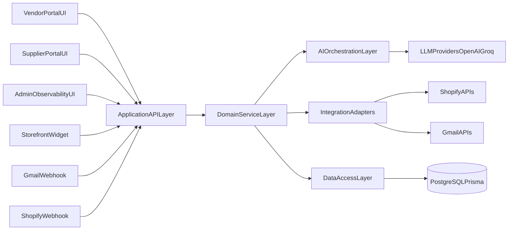

### 3.1.2 Layered Architecture Mapping

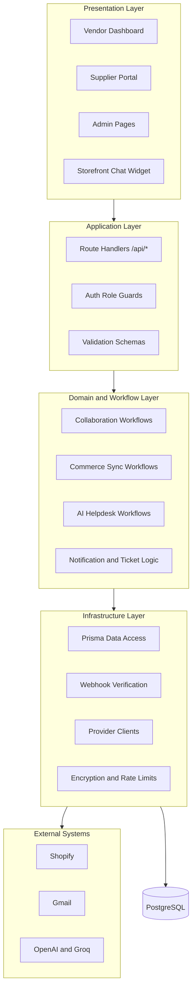

### 3.1.3 Major Module Responsibilities

| Module | Primary Responsibilities | Core Artifacts |
| --- | --- | --- |
| Identity and Access | Authentication, role checks, portal/session alignment, MFA-aware flows | Auth handlers, role guards, user/session models |
| Vendor-Supplier Collaboration | Connection lifecycle, product sync requests, supplier offers, event notifications | `Connection`, `ProductSync`, `SupplierProductOffer`, notifications |
| Commerce Synchronization | Shopify webhook verification, cache updates, sync metadata, low-stock signals | `CachedProduct`, `CachedOrder`, `CachedCustomer`, `SyncMetadata` |
| AI Helpdesk and Automation | Storefront AI responses, Gmail ingestion/auto-reply, escalation and ticket routing | Storefront chat flows, email processor, flagged email and ticket logs |
| Admin Observability | Cross-module event aggregation and health monitoring | Admin event/sync APIs and monitoring pages |

### 3.1.4 Architecture Design Rationale

- **Single deployable with clear module boundaries:** easier release management while preserving separation of concerns.
- **Data-centric workflow design:** collaboration and support are linked through shared store-scoped entities.
- **Role-gated API access:** business-critical operations are protected by actor-specific authorization behavior.
- **Fail-safe automation posture:** AI and webhook pipelines prioritize safety, idempotency, and operator takeover paths.

### 3.1.5 Visual References (Reused Assets)

The following existing assets are included as supplementary architecture references:

- 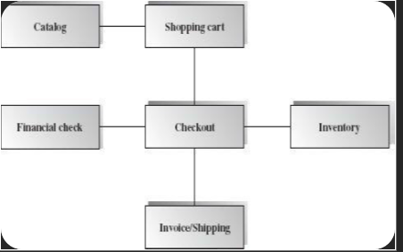
- 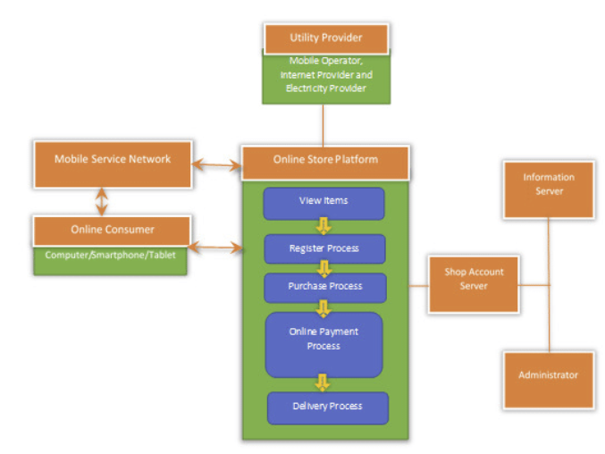

## 3.2 Design Models

JUNO combines object-oriented domain modeling with workflow/event-driven behavior. The following models represent key operational flows.

### 3.2.1 Activity Diagram: Vendor Product Sync Lifecycle

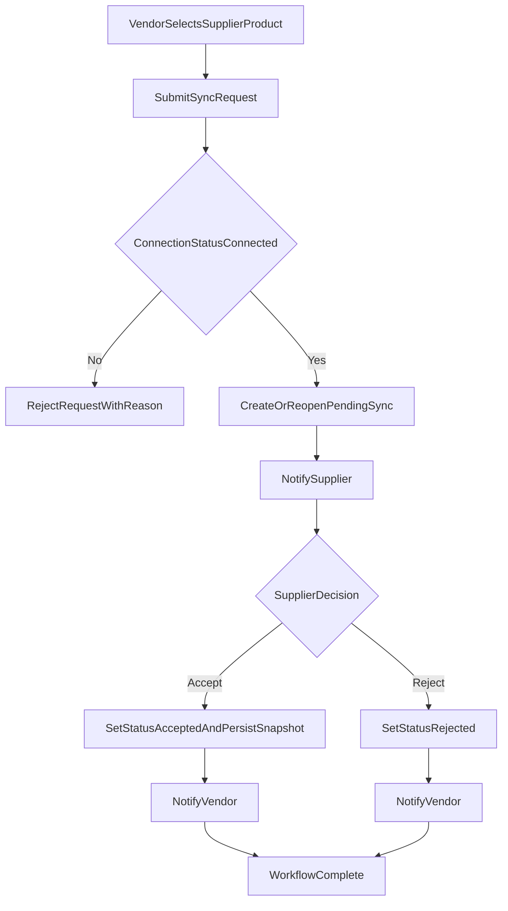

### 3.2.2 Sequence Diagram: Storefront Chat to Escalation

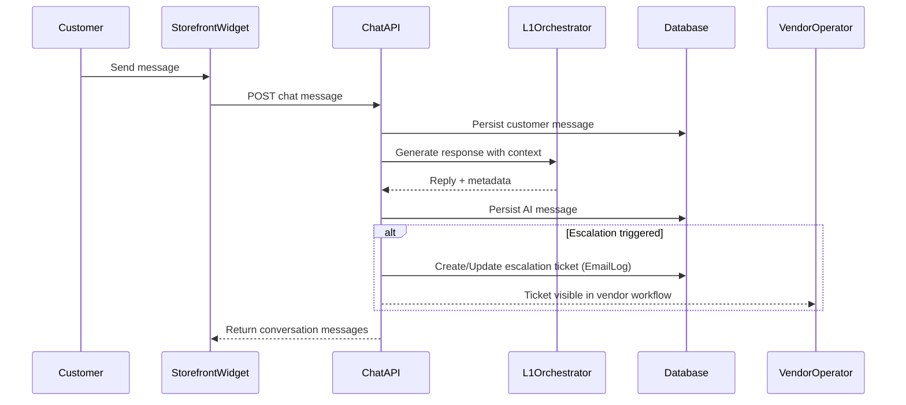

### 3.2.3 State Transition Diagram: Product Sync Entity

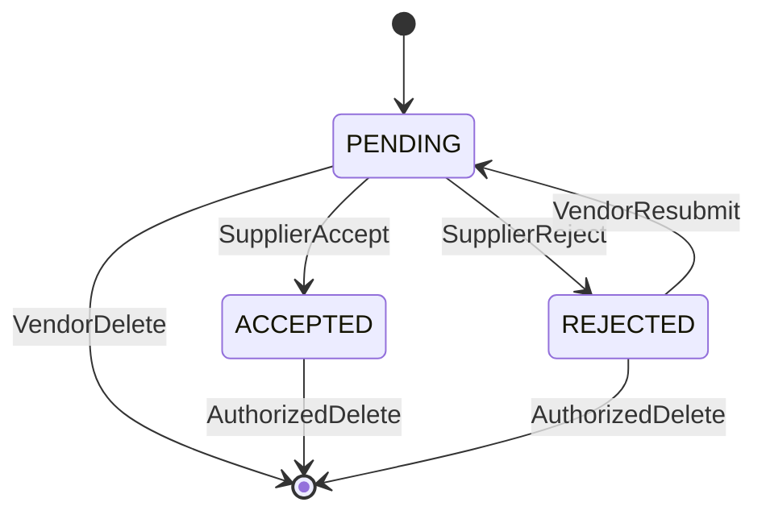

### 3.2.4 Class-Oriented Domain Structure (Conceptual)

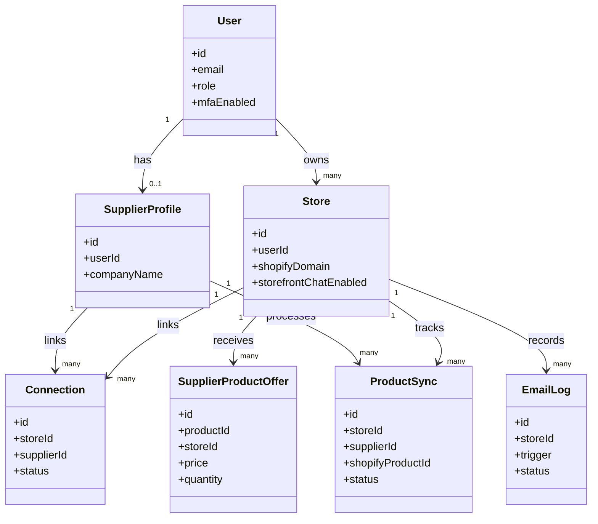

### 3.2.5 Data Flow View (Level 0)

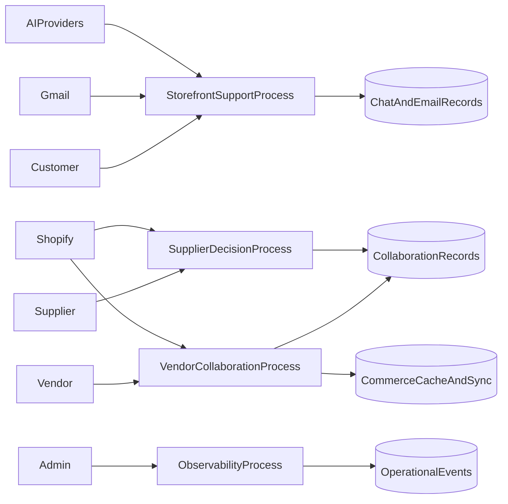

## 3.3 Data Design

JUNO transforms business interactions into store-scoped, role-aware persistent entities. The data model is implemented in PostgreSQL via Prisma and combines relational integrity with selected JSON flexibility for evolving AI/context attributes.

### 3.3.1 Data Storage Strategy

| Storage Item | Type | Purpose |
| --- | --- | --- |
| PostgreSQL relational tables | Structured transactional data | Users, stores, supplier connections, sync records, offers, notifications, logs |
| JSON columns (selected entities) | Semi-structured contextual data | Shopify payload snapshots, module policies, shared field answers, message metadata |
| Vector column (`pgvector`) | Embedding storage | Knowledge chunk retrieval for RAG-style responses |
| External provider state | Integration state | Gmail OAuth context, webhook events, Shopify synchronization inputs |

### 3.3.2 Core Data Entities and Processing Roles

| Entity Group | Operational Role |
| --- | --- |
| Identity entities (`User`, `Session`, `Account`) | Access control, role identity, authentication continuity |
| Store and collaboration entities (`Store`, `Connection`, `Invitation`) | Tenant boundary, supplier relationship governance |
| Product workflow entities (`ProductSync`, `SupplierProductOffer`) | Vendor-supplier product alignment and offer management |
| Commerce cache entities (`CachedProduct`, `CachedOrder`, `CachedCustomer`, `SyncMetadata`) | Fast query paths and synchronization observability |
| AI/helpdesk entities (`StorefrontChatConversation`, `StorefrontChatMessage`, `EmailLog`, `FlaggedEmail`) | Support automation, escalation, and communication traceability |
| Knowledge entities (`KnowledgeDocument`, `FaqItem`, `KnowledgeChunk`) | Retrieval corpus for AI-assisted answer generation |

### 3.3.3 Data Integrity and Consistency Design

- **Scoped uniqueness constraints** prevent duplicate collaboration records (for example, product sync uniqueness per store-supplier-product combination).
- **Indexing strategy** favors high-frequency filters such as `storeId`, status fields, and time-ordered event retrieval.
- **Upsert patterns** are used in synchronization metadata paths to avoid race-prone duplicate state rows.
- **Idempotent safeguards** are used in email automation paths to reduce duplicate outbound response side effects.

### 3.3.4 Security and Sensitive Data Handling

- Role-based boundaries are enforced before store-scoped data access operations.
- Sensitive credentials/tokens are kept out of client-visible payload surfaces.
- Security-relevant and operationally significant actions are persisted in logs for auditability.
- Public-facing chat endpoints apply rate controls to protect system stability and abuse posture.

### 3.3.5 Data Lifecycle (Simplified)

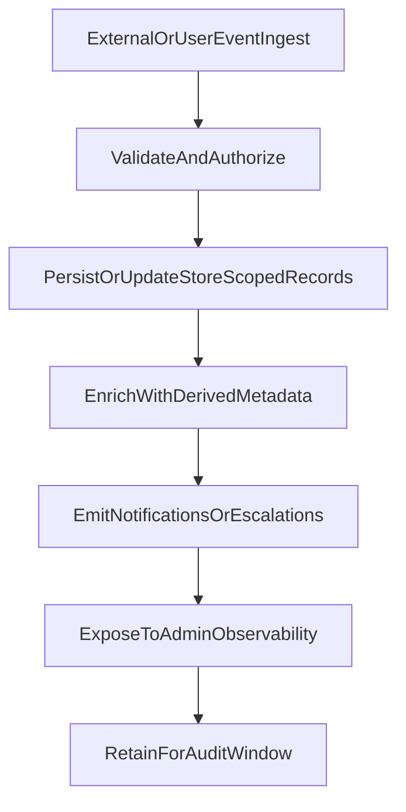

## 3.4 Domain Model

The JUNO domain model represents operational relationships between merchants, suppliers, support automation, and observability workflows.

### 3.4.1 Domain Entity Perspective

- **Actor entities:** `User` (role-bearing identity), `SupplierProfile` (supplier-specific business identity), external customer interactions via support channels.
- **Business context entities:** `Store` as tenant boundary and operational anchor.
- **Collaboration entities:** `Connection`, `Invitation`, `ProductSync`, `SupplierProductOffer`.
- **Operational data entities:** cached commerce resources and sync metadata.
- **Support and AI entities:** storefront conversation/message records, email logs, flagged emails, knowledge artifacts.

### 3.4.2 Conceptual Domain ER Diagram

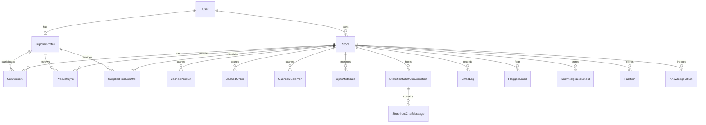

### 3.4.3 Domain Constraints and Associations

- A `Store` belongs to exactly one owning `User`, while one user can operate multiple stores.
- A `SupplierProfile` is bound to one supplier user identity and can connect to many stores through `Connection`.
- `ProductSync` and `SupplierProductOffer` provide two complementary collaboration mechanisms:
  - vendor-requested sync workflow,
  - supplier-initiated offer workflow.
- Support automation is modeled as event-bearing records rather than opaque chat history, enabling governance and analytics.

### 3.4.4 Domain Model Reference Asset

Supplementary conceptual reference from provided assets:

- 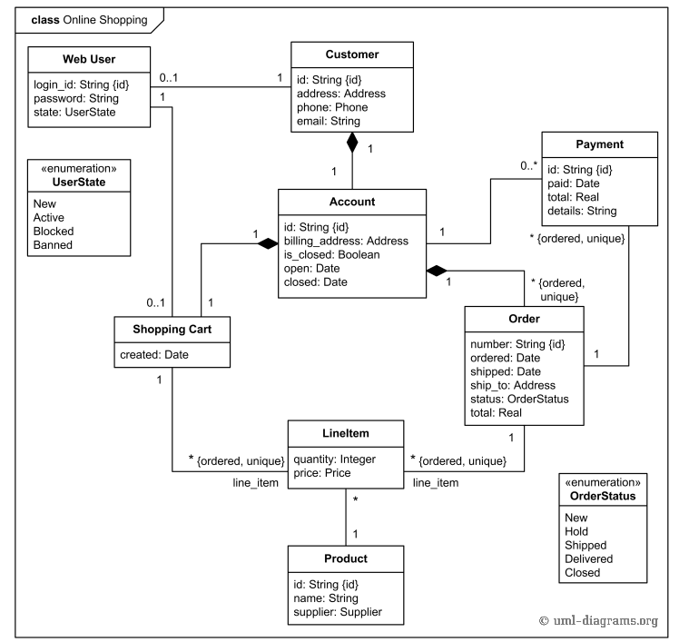

## 3.5 Chapter Summary

Section 3 establishes JUNO as a layered, role-aware workflow platform with a strong data-centric collaboration model. The design models and domain structure align with implemented modules and provide a clear bridge to implementation/testing chapters.
