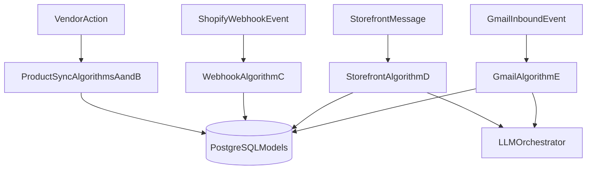
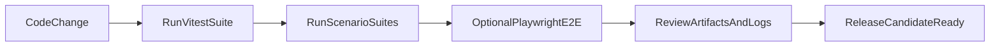
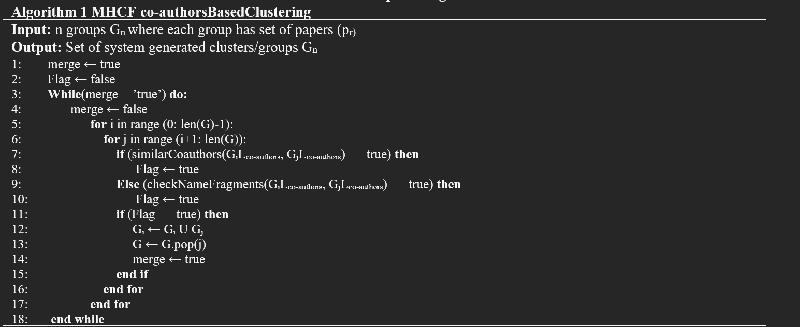
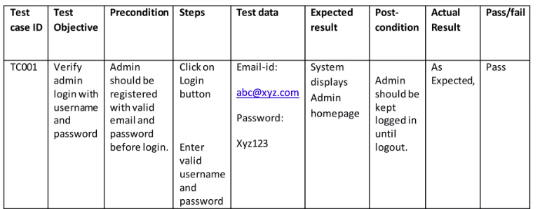

# Section 4: Implementation and Testing

This section explains how JUNO is implemented and validated. It focuses on practical algorithms used in key modules, third-party APIs/SDKs integrated in production workflows, and testing strategy with project-specific evidence.

## 4.1 Implementation Overview

JUNO is implemented as a full-stack Next.js application with App Router route handlers, Prisma-managed PostgreSQL data access, and modular AI/integration services. The implementation emphasizes:

- role-based execution paths (Vendor, Supplier, Admin),
- store-scoped workflow integrity,
- automation safety and observability,
- deterministic state transitions for collaboration operations.

Core implementation domains:

- **Collaboration engine:** vendor-supplier connection and product sync lifecycle.
- **Commerce synchronization:** Shopify webhook ingestion and cache/sync metadata updates.
- **AI support automation:** storefront and Gmail pipelines with escalation and safeguards.
- **Operational governance:** admin-level event and sync health visibility.

## 4.2 Algorithm Design

This subsection documents representative algorithms that drive major runtime behavior.

### 4.2.1 Algorithm A: Product Sync Request Creation and Reopen Logic

**Objective:** Create a new sync request only when business preconditions are valid, while safely reusing existing rejected records.

```text
Algorithm ProductSyncRequest(vendorUser, supplierId, productPayload):
1. Authorize vendor session and resolve active store.
2. Validate supplier exists and vendor-store has CONNECTED relationship with supplier.
3. Query existing sync by unique key (storeId, supplierId, shopifyProductId).
4. If existing status is ACCEPTED: reject request ("already synced").
5. If existing status is PENDING: reject request ("already pending").
6. If existing status is REJECTED:
   a. Update same row: status <- PENDING, reset rejected/accepted timestamps.
   b. Refresh product snapshot fields.
   c. Notify supplier.
   d. Return success.
7. Else create new ProductSync row with status PENDING and requester metadata.
8. Emit supplier notification.
9. Return created sync object.
```

### 4.2.2 Algorithm B: Supplier Decision State Transition

**Objective:** Enforce valid state transition from `PENDING` to `ACCEPTED`/`REJECTED` with actor ownership checks.

```text
Algorithm DecideSyncRequest(supplierUser, syncId, action):
1. Authorize supplier role and resolve supplier profile.
2. Load ProductSync(syncId) and verify supplier ownership.
3. If status != PENDING: reject ("already processed").
4. If action == ACCEPT:
   a. status <- ACCEPTED
   b. acceptedAt <- now
   c. derive supplier_quantity snapshot from product variants (if available)
5. Else if action == REJECT:
   a. status <- REJECTED
   b. rejectedAt <- now
6. Persist update.
7. Notify vendor about decision.
8. Return updated status response.
```

### 4.2.3 Algorithm C: Shopify Webhook Verification and Sync Metadata Update

**Objective:** Process only authentic webhooks and maintain synchronization health state.

```text
Algorithm ProcessShopifyWebhook(headers, rawBody):
1. Extract hmac, topic, and domain headers; fail fast if missing.
2. Resolve store by normalized domain variants.
3. Verify HMAC using store-specific API secret.
4. If verification fails: return unauthorized.
5. Switch by topic:
   - orders/create or orders/updated:
     update order cache; upsert SyncMetadata(resource="orders", status="success").
   - products/create or products/update:
     update product cache;
     trigger low-stock evaluation;
     attempt auto-link of supplier offers;
     upsert SyncMetadata(resource="products", status="success").
   - products/delete:
     remove cached product;
     upsert SyncMetadata(resource="products", status="success").
6. Log processing outcome and return success.
```

### 4.2.4 Algorithm D: Storefront AI Reply with Escalation Gate

**Objective:** Generate a bounded AI response and escalate when metadata or content signals require human handling.

```text
Algorithm StorefrontReplyWithEscalation(store, visitor, message):
1. Apply endpoint and conversation-level rate limits.
2. Resolve/create conversation for (storeId, visitorId).
3. Persist customer message.
4. Gather recent conversation history.
5. Run L1 orchestrator with module flags, shared fields, and session-bound identity state.
6. Persist AI response message.
7. Evaluate escalation trigger:
   - usedTools contains "ticket_intake", or
   - module indicates human escalation, or
   - response includes escalation handoff phrases.
8. If escalation true:
   a. Create/update EmailLog ticket artifact with storefront trigger.
9. Return response payload with messages + AI metadata.
```

### 4.2.5 Algorithm E: Gmail Auto-Reply Safety Pipeline

**Objective:** Produce reliable, non-duplicate, policy-safe automated replies for vendor accounts.

```text
Algorithm ProcessIncomingGmail(userId, storeId):
1. Resolve Gmail token; abort if not connected.
2. Fetch latest unread candidate email(s).
3. Parse sender and fetch full email content.
4. Run abuse/safety screening:
   - If flagged: persist FlaggedEmail, mark message read, stop.
5. Persist inbound EmailLog event.
6. Apply rate-limit checks for store+sender.
7. Acquire idempotency lease for inbound message ID.
8. Generate auto-reply preview/classification and final HTML.
9. Send reply and persist result.
10. Mark original email as read.
11. Release lease on failure paths and return execution result.
```

### 4.2.6 Algorithm Interaction Diagram



## 4.3 External APIs and SDKs

JUNO integrates multiple third-party services. The following table lists major external dependencies used directly in implementation workflows.

| API/SDK and Version | Description | Purpose in JUNO | Example Endpoint / Class / Function Usage |
| --- | --- | --- | --- |
| Shopify Admin API (2024-01 routes used) | Commerce platform API for products/orders/webhooks | Store onboarding, webhook registration, data synchronization | `POST https://{shop}/admin/api/2024-01/webhooks.json`, webhook handler `/api/webhooks/shopify` |
| Gmail API (Google OAuth2 + Gmail REST) | Email integration and mailbox event processing | Vendor email automation, inbound processing, auto-replies | OAuth authorization URL builder, `users/me/messages`, webhook `/api/webhooks/gmail` |
| OpenAI SDK `openai` (`^4.104.0`) | LLM and embedding provider | Knowledge embeddings and optional chat completion flows | OpenAI chat/embedding calls through internal AI service wrappers |
| Groq API client integration | LLM inference provider | Primary/fallback completion paths for support automation and classification | `groqChatCompletion` usage in `aiChatCompletion` workflow |
| NextAuth/Auth.js (`next-auth`, `@auth/*`) | Authentication/session framework | Multi-role session and portal-specific auth behavior | `NextAuth(...)`, adapter + callbacks + role-aware auth resolution |
| Prisma ORM (`prisma`, `@prisma/client`) | Database access and schema management | Type-safe data access, migrations, constraints, relations | `prisma.*` model operations and migration lifecycle scripts |
| Upstash Rate Limit (`@upstash/ratelimit`, `@upstash/redis`) | Request throttling primitives | Public chat anti-abuse and throughput protection | `applyRateLimit(...)` in storefront/public API flows |
| AWS SDK S3 (`@aws-sdk/client-s3`) | Object storage integration | Media upload/storage path for assets (environment-dependent) | S3 client calls for supplier/storefront image paths |
| Nodemailer (`nodemailer`) | Email transport abstraction | Outbound email delivery and logging in support workflows | Email send service + `EmailLog` persistence |
| Otplib (`otplib`) | TOTP validation library | MFA verification for credential-based auth paths | `verify({ token, secret })` in authentication flow |

### 4.3.1 API Integration Design Notes

- External integrations are wrapped behind service and route boundaries to isolate provider concerns from domain logic.
- Webhook integrations use explicit verification/normalization before business processing.
- AI provider selection is configurable, with controlled fallback behavior and structured logging.

## 4.4 Testing Details

JUNO testing combines unit tests, integration-style tests, and targeted scenario suites for high-risk automation paths.

### 4.4.1 Test Stack

- **Primary test runner:** Vitest
- **E2E capability:** Playwright
- **Specialized scenario harness:** Gmail auto-reply test environment using Dockerized dependencies

### 4.4.2 Test Scope by Module

| Module Area | Typical Test Type | Example Coverage |
| --- | --- | --- |
| API validation and authorization | Unit/integration | Route-level guards, forbidden access, schema validation |
| Product sync and inventory logic | Unit | Offer matching, quantity reconciliation, auto-link helper logic |
| Shopify/order automation utilities | Unit | Hold synchronization, line-item parsing and transforms |
| AI support utility logic | Unit/scenario | Gmail context extraction, order disclosure rules, classification invariants |
| Gmail automation pipeline | Integration-style scenario | End-to-end preview/output assertions across curated scenarios |

### 4.4.3 Representative Existing Test Assets

The following current tests demonstrate implemented quality gates:

- `tests/gmail-auto-reply/run.test.ts`
- `src/lib/products/autoLinkOfferToShopifyProduct.test.ts`
- `src/lib/automation/ticketSupplierRouting.test.ts`
- `src/app/api/chat/messages/post.test.ts`
- `src/lib/api-schemas/schemas.test.ts`
- `src/lib/shopify/orderHoldSync.test.ts`
- `tests/l1/orderTools.test.ts`

### 4.4.4 Testing Workflow



### 4.4.5 Unit Testing Strategy

- Target deterministic helper functions first (normalization, mapping, parsing, guard logic).
- Validate edge-case behavior explicitly (null/empty/ambiguous inputs).
- Mock external boundaries (auth, DB client, push/external calls) for stable and isolated tests.
- Include authorization-failure tests on sensitive route handlers.

### 4.4.6 Integration and Scenario Testing Strategy

- Use scenario-based assertions for Gmail auto-reply behavior and classifier invariants.
- Validate response safety paths: off-topic suppression, missing-order handling, escalation conditions.
- Record artifacts for auditability and debugging of AI path outcomes.

### 4.4.7 Suggested Section 4 Test Evidence Table (for report/viva)

| Test ID | Objective | Method | Expected Result |
| --- | --- | --- | --- |
| T-API-AUTH-01 | Ensure unauthorized actor cannot post restricted chat payload | Route test with mocked auth/session | HTTP 403 returned |
| T-SYNC-STATE-01 | Ensure rejected sync can be reopened correctly | Product sync workflow test | Existing row reused with `PENDING` status |
| T-WEBHOOK-SEC-01 | Ensure invalid Shopify signature is rejected | Webhook handler security test | Request denied; no data mutation |
| T-AI-ESC-01 | Ensure escalation tickets are created on escalation signal | Storefront AI integration test | `EmailLog` escalation record is created/updated |
| T-GMAIL-SAFE-01 | Ensure flagged abusive email does not get auto-reply | Gmail scenario test | Email flagged, no outbound reply sent |
| T-GMAIL-IDEMP-01 | Ensure duplicate inbound message is not double-replied | Lease/idempotency scenario test | First process replies; duplicate is skipped |

### 4.4.8 Testing References (Reused Assets)

- 
- 

## 4.5 Chapter Summary

Section 4 documents JUNO’s implementation through concrete algorithms, production integrations, and test practices that emphasize correctness, safety, and operational reliability. The chapter provides a direct bridge from system design to verifiable execution behavior.
